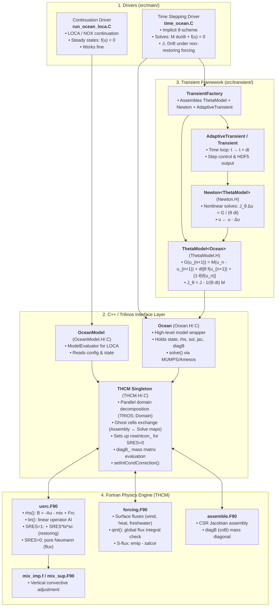

# Ocean Model: Continuation vs Implicit Time Integration & Drift Analysis

## 1. Overview and Project Structure

This project consists of a legacy Fortran ocean model (**THCM**) coupled with the C++ **Trilinos** library for parallel linear algebra and solvers. The linear systems are solved using direct solvers via the Trilinos/Amesos interface to **MUMPS**.

The primary drivers of interest are:
- **`src/main/run_ocean_loca.C`**: Continuation driver using LOCA (Library of Continuation Algorithms) / NOX. Computes steady states along parameter branches ($f(u) = 0$). Works reliably.
- **`src/main/time_ocean.C`**: Implicit time integration driver using a $\theta$-timestepping scheme. Solves $M \frac{du}{dt} + f(u) = 0$. Exhibits unphysical behavior ("drift") when non-restoring surface forcing is used.



---

## 2. Architectural Comparison

| Component | Continuation (`run_ocean_loca.C`) | Implicit Time Stepping (`time_ocean.C`) |
| :--- | :--- | :--- |
| **Mathematical Problem** | Steady state: $f(u) = 0$ | DAE / ODE: $M \frac{du}{dt} + f(u) = 0$ |
| **Model Evaluator** | `OceanModel` $\to$ `THCM` | `ThetaModel<Ocean>` $\to$ `Ocean` $\to$ `THCM` |
| **Linear Solve per Newton step** | $J \, \Delta u = -f(u)$ | $(J - \frac{1}{\theta \Delta t} M) \Delta u = \frac{1}{\theta \Delta t} G(u)$ |
| **Salinity Null Space Handling** | Singular Jacobian requires gauge/integral condition | Diagonal $-\frac{1}{\theta \Delta t} M_{SS}$ naturally regularizes $S$ equation |
| **Constraint Treatment** | Algebraic constraint replacing one cell row is mathematically exact at steady state | Replacing one cell's dynamic equation breaks local mass conservation |

---

## 3. The Drift Issue Under Non-Restoring Surface Forcing

When non-restoring surface forcing (`SRES = 0`) is applied, salinity boundary conditions switch from restoring (Robin/Dirichlet: $\gamma (S - S^*)$) to prescribed freshwater flux (Neumann: $E - P$).

Three key mechanisms are primary suspects for the drift in `time_ocean.C`:

### 1. Artificial Salt Source/Sink via `rowintcon_`
In steady-state continuation (`run_ocean_loca.C`), the pure Neumann problem has a 1D null space (arbitrary additive constant in $S$). To regularize it:
- In `THCM::evaluate` (`src/ocean/THCM.C`), row `rowintcon_` (a single grid cell) has its PDE equation overwritten with $\int S \, dV - C$.
- In `THCM::intcond_S` and `THCM::evaluateB` (`src/ocean/THCM.C`), `diagB_[rowintcon_]` is set to `0.0`.

**In time-stepping (`src/transient/ThetaModel.H`)**:
- For cell `rowintcon_`, the physical time derivative $M_i \frac{S_i^{n+1} - S_i^n}{\Delta t}$ is removed.
- Surrounding cells still transport salt into/out of cell `rowintcon_` via advection and diffusion.
- To satisfy $\int S \, dV = C$, cell `rowintcon_` is forced to artificially absorb or inject all net domain imbalances, acting as an unphysical local source/sink that diffuses across the basin.

### 2. Discrete Surface Flux Balance Mismatch (`salcor` vs 3D Metric)
In `src/ocean/forcing.F90` and `THCM.C::thcm_forcing_integral_`:
- `salcor` is subtracted to make $\int (E - P - salcor) \, dA = 0$.
- If the integration weights in `thcm_forcing_integral_` ($\cos(y_j)$) differ even slightly from the discrete horizontal cell surface areas used in finite-volume assembly in `usrc.F90` / `assemble.F90`, the net salt input $\sum_{surface} F_{i,j}$ into the ocean is non-zero, causing monotonic drift in total salt.

### 3. Handling of `Local SRES Only`
Commit `ef2123d` introduced `Local SRES Only`:
```cpp
if (localSres_)
    sres_ = 1; // from here on we ignore the integral condition on the parallel side
```
If enabled, the integral condition is bypassed, but if the net surface flux or vertical convective adjustment (`mix_imp.f`) does not strictly conserve total salt to machine precision, unconstrained time integration will drift.

---

## 4. Next Steps
1. Fix unit test infrastructure to establish baseline testing.
2. Verify whether `rowintcon_` is active during time stepping and observe the residual and state at `rowintcon_` across time steps.
3. Compare the global discrete sum of `diagB_ * state_` (total volume-weighted salt) across consecutive time steps.
